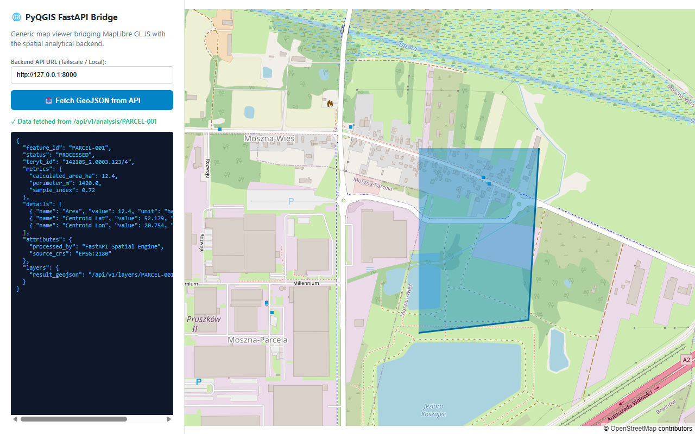
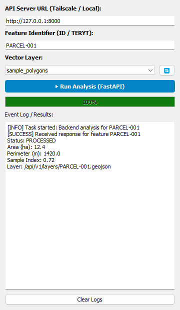
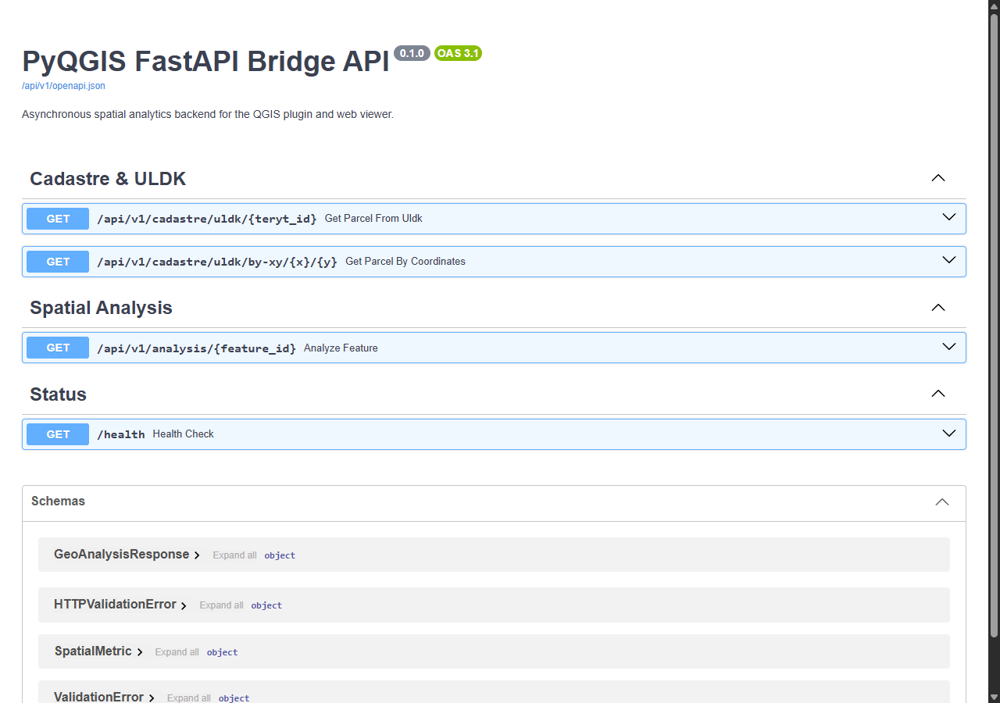

# PyQGIS FastAPI Bridge

A boilerplate connecting desktop QGIS, a FastAPI spatial analytics backend, and a MapLibre GL JS web map.

Built for spatial engineering workflows that require background processing without freezing QGIS, unified Pydantic schemas, and ready-to-use connectors for Polish public GIS registries (GUGiK ULDK, IMGW) with native support for EPSG:2180 (PUWG 1992).

---

## Overview

| Web Map Viewer (MapLibre GL JS + OSM) | QGIS Desktop Plugin (PyQGIS DockWidget) |
| :---: | :---: |
|  |  |
| *Browser viewer with fetched GeoJSON polygon overlay and API output* | *QGIS dock panel with asynchronous `QgsTask` processing and logs* |

<p align="center">
  
  <br />
  <em>Interactive OpenAPI documentation served at <code>/docs</code></em>
</p>

---

## Architecture

```text
                   ┌──────────────────────────────────────────────┐
                   │             Backend (FastAPI)                │
                   │   Async REST API + GUGiK ULDK + IMGW Telemetry│
                   └──────────────────────┬───────────────────────┘
                                          │  REST API (Pydantic / GeoJSON)
                  ┌───────────────────────┴───────────────────────┐
                  ▼                                               ▼
         QGIS Plugin                                     Web Viewer
     (PyQGIS + QgsTask)                              (MapLibre GL JS)
  Runs requests in background thread;            In-browser map with GeoJSON
  zero UI freeze during processing               layers on OpenStreetMap tiles
```

---

## Core Features

- **Non-blocking PyQGIS processing (`QgsTask`):** Heavy spatial computation and network requests run in a background worker thread. The QGIS canvas remains fully responsive (pan, zoom, select) while tasks execute.
- **National registry connectors (`backend/app/ingestion/`):**
  - **GUGiK ULDK (`uldk_connector.py`):** Real-time cadastral parcel boundary lookup by TERYT ID or clicked map coordinates (EPSG:2180).
  - **IMGW-PIB (`imgw_connector.py`):** Live telemetry, synoptic weather observations, and hydrological data across Poland.
  - **Public registry catalog:** 40+ curated services (WMS, WFS, STAC, CSW) documented in [`docs/polish_public_gis_registries.md`](docs/polish_public_gis_registries.md).
- **Coordinate reference system utilities (`shared/constants/poland_crs.py`):** Verified transforms and bounds for EPSG:2180 (PUWG 1992), EPSG:4326 (WGS 84), and EPSG:3857 (Web Mercator).
- **Shared data contracts (`shared/schemas/geo_models.py`):** Unified Pydantic models (`GeoFeatureRequest`, `SpatialMetric`, `GeoAnalysisResponse`) shared between the backend, QGIS plugin, and frontend.
- **Peer-to-peer team sharing via Tailscale:** Work directly with teammates over a shared Tailscale mesh network without requiring commits or cloud deploys.

---

## Quick Start

### Prerequisites
- **QGIS:** QGIS 3.44.15 LTR (or any 3.28+ LTR) with Python 3.10+
- **Python:** Python 3.10, 3.11, 3.12, or 3.13
- **OS:** Windows, macOS, or Linux

### 1. Start the Backend
```bash
python backend/run_backend.py
```
- API root: `http://127.0.0.1:8000`
- Swagger UI: `http://127.0.0.1:8000/docs`
- Health check: `http://127.0.0.1:8000/health`

### 2. Open the Web Viewer
The web viewer is served directly by FastAPI:
- Open in browser: `http://127.0.0.1:8000`
- Source file: [`web/index.html`](web/index.html)

### 3. Load the QGIS Plugin
1. Link the plugin into your QGIS profile:
   - Windows: run `link_plugin.bat`
   - Linux / macOS: run `./link_plugin.sh`
2. Open sample data:
   - Open [`sample_project/sample_project.qgs`](sample_project/sample_project.qgs) or drag & drop [`sample_project/sample_polygons.geojson`](sample_project/sample_polygons.geojson) into QGIS.
3. Enable the plugin:
   - Go to **Plugins -> Manage and Install Plugins... -> Installed** and check **PyQGIS FastAPI Bridge**.
4. Click the bridge icon on the toolbar to show the dock panel.
5. Click **Run Analysis (FastAPI)** to dispatch tasks via `QgsTask` without freezing the interface.

### 4. Run Automated Tests
```bash
# Windows
run_tests.bat

# Linux / macOS
./run_tests.sh

# Or directly with unittest
python -m unittest discover -s tests -p "test_*.py" -v
```
All 16 unit tests cover API routes, schemas, CRS helpers, GUGiK/IMGW connectors, and plugin structure.

---

## Tailscale Workflow (Team Collaboration)

To share analysis models or run services across team members on a local network:
1. Start the backend: `python backend/run_backend.py` (binds to `0.0.0.0:8000`).
2. Obtain your Tailscale IP (e.g. `100.x.y.z`) or MagicDNS name.
3. Teammates enter `http://<tailscale-ip>:8000` in their QGIS plugin dock panel or open `http://<tailscale-ip>:8000` in a browser.
4. Alternatively, configure `PYQGIS_BRIDGE_API_URL` in `.env`.

---

## Customizing the UI in Qt Designer

1. Launch Qt Designer via `open_designer.bat` (uses QGIS-bundled Qt Designer with QGIS custom widgets).
2. Edit `qgis_plugin/pyqgis_fastapi_bridge/gui/dockwidget.ui`.
3. Changes reload dynamically without needing to recompile `.ui` files.

---

## Project Structure

```text
pyqgis-fastapi-bridge/
├── backend/                  # FastAPI analytical engine
│   ├── app/
│   │   ├── api/v1/           # Endpoints (analysis, cadastre)
│   │   ├── core/             # Configuration and settings
│   │   └── ingestion/        # GUGiK ULDK & IMGW-PIB connectors
│   └── run_backend.py        # Backend runner script
├── qgis_plugin/              # PyQGIS desktop plugin
│   └── pyqgis_fastapi_bridge/
│       ├── core/             # Background QgsTask workers and API client
│       ├── gui/              # Qt dockwidget and .ui layout
│       └── metadata.txt      # QGIS plugin metadata
├── shared/                   # Shared modules (backend + plugin)
│   ├── constants/            # EPSG:2180, EPSG:4326 definitions
│   └── schemas/              # Pydantic data contracts
├── web/                      # MapLibre GL JS web client (served by FastAPI)
│   └── index.html
├── sample_project/           # Sample QGIS project and test GeoJSON
├── docs/                     # Documentation and screenshot assets
│   ├── images/               # Visual verification screenshots
│   └── polish_public_gis_registries.md
├── tests/                    # 16 automated unit tests
├── link_plugin.bat           # Symlink plugin to QGIS profile (Windows)
├── link_plugin.sh            # Symlink plugin to QGIS profile (POSIX)
├── run_tests.bat             # Test runner (Windows)
├── run_tests.sh              # Test runner (POSIX)
├── start_all.bat             # One-click startup script (Windows)
└── requirements.txt          # Python dependencies
```

---

## License & Data Attribution

- **Code:** [MIT License](LICENSE)
- **Public Data Sources:**
  - **GUGiK:** Open cadastral parcel geometry (ULDK), PRG, BDOT10k, NMT (LiDAR).
  - **IMGW-PIB:** Public meteorological and hydrological data.
  - **OpenStreetMap:** Base map tiles © [OpenStreetMap contributors](https://www.openstreetmap.org/copyright).
